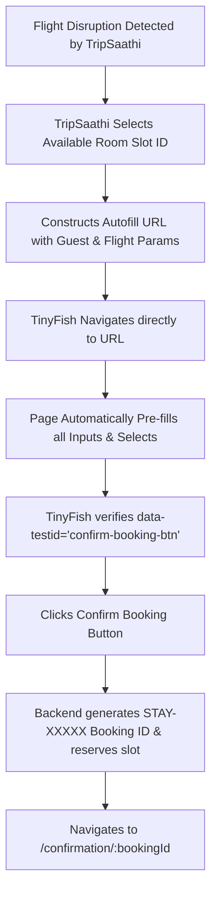

# StayPulse Autofill Booking Link Integration Guide
**Autonomous Agent (TinyFish / TripSaathi) Seamless Hotel Slot Reservation**

---

## 1. Overview & Objectives

In airline disruption recovery scenarios (e.g. flight delays or cancellations handled by **TripSaathi**), an autonomous agent like **TinyFish** must reserve a hotel room slot quickly without manual form entry or brittle DOM input simulations.

To achieve this, StayPulse provides a **Parameterized Autofill Booking Route**:
- Any agent or user can navigate to `/book/<room_id>?<params>`
- All guest details, stay dates, flight disruption notices, arrival windows, and payment modes are extracted from URL query parameters and pre-populated into the form automatically.
- TinyFish can either verify and click the confirmation button (`data-testid="confirm-booking-btn"`) with 1 action or the user can finalize the reservation instantly.

---

## 2. URL Specification & Format

### Base URL Structure
```text
https://stay-pulse.vercel.app/book/<ROOM_ID>?<QUERY_PARAMETERS>
```

- **Production:** `https://stay-pulse.vercel.app/book/<ROOM_ID>?...`
- **Local Dev:** `http://localhost:5000/book/<ROOM_ID>?...`

---

## 3. Query Parameters Reference

The system supports standard parameter keys along with convenient aliases:

| Parameter | Aliases | Type | Example Value | Description & Behavior |
| :--- | :--- | :--- | :--- | :--- |
| `name` | `guest_name` | string | `Rahul Sharma` | Populates the Primary Guest Name field. |
| `email` | `guest_email` | string | `rahul@gmail.com` | Populates the Guest Email for confirmation and receipt. |
| `phone` | `guest_phone` | string | `%2B919876543210` | Populates Contact Phone (use `%2B` for `+` encoding). |
| `flight` | `flight_no`, `flight_number` | string | `AI-804` | Auto-generates disruption notice: `"Holding check-in due to flight delay AI-804 arriving late"`. |
| `arrival` | `arrival_time`, `expected_arrival` | string | `late` or `20:00` | Intelligently maps to `"Late Arrival: After 20:00"`, `"14:00 - 16:00"`, `"16:00 - 18:00"`, or `"18:00 - 20:00"`. |
| `hold` | `late_hold` | boolean | `true` or `1` | Toggles the checkbox: *"Request Guaranteed Check-in Hold until 23:59"*. |
| `special_requests` | `request`, `notes` | string | `High floor room preferred` | Custom requests sent to hotel front desk. Overrides default flight notice if set. |
| `payment` | `payment_mode`, `pay` | string | `pay_at_property` or `online` | Selects either **Pay at Property** (₹0 upfront, reserved instantly) or **Online Razorpay**. |
| `checkin` | `checkin_date` | string (YYYY-MM-DD) | `2026-10-22` | Check-in calendar date. Defaults to current day if omitted. |
| `checkout` | `checkout_date` | string (YYYY-MM-DD) | `2026-10-24` | Check-out calendar date. Defaults to check-in + 2 days if omitted. |
| `guests` | `adults` | integer | `2` | Number of adults accommodated in the slot. |

---

## 4. What Was Implemented

### 1. Smart Parameter Parsing & Resolution (`frontend/src/pages/BookingPage.jsx`)
- **Fuzzy Arrival Resolution (`resolveArrival`)**:
  - Matches keywords like `late`, `20`, `night`, `after` to `"Late Arrival: After 20:00"`.
  - Matches `14` or `afternoon` to `"14:00 - 16:00"`.
  - Matches `16` to `"16:00 - 18:00"`.
  - Matches `18` to `"18:00 - 20:00"`.
- **Flight Disruption Recovery Formatter (`resolveSpecialRequests`)**:
  - If a flight number is passed (e.g. `flight=AI-804`) and no custom `special_requests` was specified, it automatically formats:
    `Holding check-in due to flight delay AI-804 arriving late`
- **Flexible Payment Mode Resolver (`resolvePayment`)**:
  - Recognizes `pay_at_property`, `property`, `offline`, `later`, `desk` -> `PAY_AT_PROPERTY`.
  - Recognizes `online`, `razorpay`, `card`, `upi` -> `ONLINE_RAZORPAY`.
- **Guaranteed Front Desk Hold Resolver (`resolveHold`)**:
  - Parses `true`, `1`, `yes`, `on`, `required` to enable the hold checkbox. Defaults to `true` for airline disruption recovery.

### 2. Reactive State Synchronization
- State variables (`name`, `email`, `phone`, `checkinDate`, `checkoutDate`, `guestsCount`, `expectedArrival`, `lateHoldRequested`, `specialRequests`, `paymentMode`) are initialized with the resolved query parameters.
- Added a `useEffect` hook listening to `searchParams` so if an agent or router updates the URL query string dynamically, the form inputs update immediately.

### 3. "Smart Autofill Active" Visual Notification
- When query parameters are detected (`hasAutofillParams === true`), a notification banner appears at the top:
  - *"Smart Autofill Active — Guest details, arrival window, and flight disruption notice were pre-populated automatically via your booking link."*
  - Tagged with a **"TinyFish / TripSaathi Linked"** badge.

### 4. Interactive "Copy / Share Autofill Link" Feature
- Added two one-click copy buttons:
  1. Top header pill button: `[Share / Copy Autofill Link]`
  2. Right-hand sidebar developer widget: `[Copy Autofill URL]`
- Clicking generates a full URL encoded with the current values of all fields on the page and copies it to the system clipboard.
- This allows developers and testers to adjust inputs on the UI and instantly generate test links for TinyFish.

---

## 5. Live Examples

### Example 1: Full Disruption Recovery (Flight Delay + Pay at Property)
```text
https://stay-pulse.vercel.app/book/6ad105503c1fd4003fa477c3?name=Rahul+Sharma&email=rahul%40example.com&phone=%2B919876543210&flight=AI-804&arrival=late&hold=true&payment=pay_at_property
```

**Result upon loading:**
- **Room**: Deluxe Sea-View King Room at *Taj Lands End*
- **Primary Guest Name**: `Rahul Sharma`
- **Email Address**: `rahul@example.com`
- **Phone Number**: `+91 9876543210`
- **Arrival Time**: `Late Arrival: After 20:00`
- **Guaranteed Hold**: Checked (`true`)
- **Special Request**: `Holding check-in due to flight delay AI-804 arriving late`
- **Payment Method**: `Pay at Property (₹0 Due Today)`
- **Banner**: Displays *"Smart Autofill Active — TinyFish / TripSaathi Linked"*

---

### Example 2: Minimal Parameters (Auto-generates fallbacks)
```text
https://stay-pulse.vercel.app/book/6ad105503c1fd4003fa477c3?name=Priya+Patel&email=priya%40test.com&flight=6E-205
```

---

## 6. TinyFish Automation Selectors Guide

TinyFish agents can easily target the booking page using stable `data-testid` attributes:

| Element | Selector / Test ID |
| :--- | :--- |
| Guest Name Input | `[data-testid="guest-name-input"]` |
| Guest Email Input | `[data-testid="guest-email-input"]` |
| Guest Phone Input | `[data-testid="guest-phone-input"]` |
| Guest Count Select | `[data-testid="guest-count-select"]` |
| Arrival Time Select | `[data-testid="arrival-time-select"]` |
| Special Requests Input | `[data-testid="special-requests-input"]` |
| Pay At Property Option | `[data-testid="payment-method-pay-at-property"]` |
| Razorpay Online Option | `[data-testid="payment-method-razorpay"]` |
| **Confirm Reservation Button** | `[data-testid="confirm-booking-btn"]` |

---

## 7. TinyFish Crawling / Booking Workflow



---

## 8. Git Commit Log

- **Commit**: `e9a3a59`
- **Message**: `feat: add comprehensive query parameter autofill and share link for TinyFish`
- **Repository**: `https://github.com/Chinmay-Kapila/StayPulse.git`
- **Deployment**: Automatically redeployed on Vercel (`https://stay-pulse.vercel.app`)
